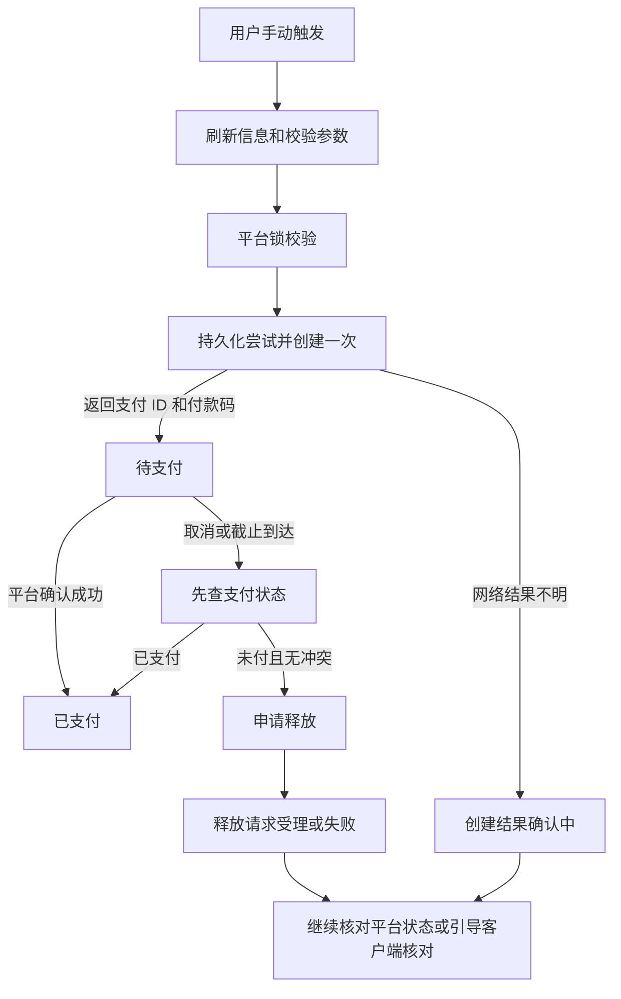

# 业务流程与状态机

> v1.0 · 2026-11-07 · 正常及异常路径均按本文件执行

## 1. 启动、身份与恢复

1. 获取应用单实例锁，打开数据库并完成迁移；初始化托盘、通知协议及主窗口。
2. 读取当前客户端登录态，调用用户信息接口确认身份；无凭证、过期、解析失败分别进入既定引导页。
3. 按官方用户 ID 选择本地作用域，优先处理未结束的订单记录，再启动收藏同步和监测。
4. 第一轮监测仅建立状态基线，不弹“刚变可租”通知；列表和角标仍展示当前可租数。
5. 运行中遇到登录失效，暂停平台请求、扫描和监测；保留本地数据与出码恢复记录。重新读取且身份相同后恢复；身份不同则取消旧任务并进入新用户作用域。
6. 主窗口关闭默认进入托盘；托盘“退出”才结束进程。系统关机、崩溃或强制终止由重启恢复处理，不依赖退出回调一定执行。

应用首次出码前，详情下单区要求用户阅读平台租赁协议和占号风险，并主动勾选“已阅读并同意”；按平台用户与协议版本保存确认。平台协议状态未完成时引导回 5E 客户端完成，助手不代签。完成设置后，“一键出码”沿用 Q13，不额外弹确认框。

## 2. 统一请求调度

| 参数 | 确定值/算法 |
|---|---|
| 总速率 | 默认 30 次/分钟，可设任意正整数；超过 30 显示既定风险提示 |
| 执行方式 | 平台业务请求共用一个执行队列，同时最多 1 个；重试也计入 |
| 平滑限速 | 相邻请求起点至少间隔 `60000/R` 毫秒，并满足最近 60 秒内不超过 R 次 |
| 优先级 | 订单状态核对/释放 → 用户出码预检与创建 → 用户详情/手动操作 → 收藏监测与同步 → 搜索分页和库存扫描 |
| 支付轮询 | 间隔 `max(3000, ceil(90000/R))` 毫秒；不与上一轮未完成请求重叠 |
| 后台处理 | 有创建中、待支付或结果核对中的订单时暂停库存扫描；其余后台请求使用剩余预算 |
| 监测 | 默认 60 秒，下限 30 秒；一轮未结束不重叠启动，结束后再等待配置间隔 |
| 立即检查 | 遵守全局预算和 30 秒冷却；正在检查时复用当前任务 |
| 只读重试 | 网络错误/5xx 最多重试 2 次，退避 2 秒、5 秒；429 遵守 Retry-After，无该值则 60 秒暂停 |
| 写入重试 | 创建、预检、解锁不自动重发；收藏按目标状态和 revision 在下轮同步重试 |

请求预算始终是上限，任何优先级都不能越过上限。界面显示队列等待与扫描暂停原因；请求本身在排队时不启动网络超时计时。用户降低速率后立即按新预算执行，既往请求仍计入窗口。

## 3. 筛选流程

`IDLE → CANDIDATES → VERIFYING → COMPLETE`；活动阶段可以进入 `STOPPED` 或 `FAILED`。

1. 校验条件，生成不可变条件快照和递增 `scanId`。每行类别/名称至少填一项；完全没有饰品条件时执行租期/价格浏览。
2. 对每个非空条件选一个中文关键词：有名称优先名称，否则取类别映射词；不把多个词拼成一次平台搜索。
3. 获取各关键词的候选第一页，按平台返回候选数从少到多补齐分页；按 `accountNo` 取交集。空交集立即结束，不扫全站库存。
4. 加入符合价格/租期范围的本地已知账号，逐个刷新状态；“全部”指这些账号与当前平台候选的并集。结果明确标注本次搜索范围。
5. 顺序读取完整库存或有效库存缓存。同一行必须由同一件饰品满足；行与行是账号级 AND。每个满足条件的账号立即追加结果。
6. 匹配度为命中任意条件的不同饰品件数。同一饰品命中多行只计一件。列表上的展示位、卖点、价格标签不能作为完整库存命中证据。
7. 所有含饰品条件的扫描都进行完整库存确认，保证命中图和匹配度准确；纯租期/价格浏览只在打开详情时加载完整库存。
8. 默认价格比较使用所选租期原价；首单/活动价另作标签，详情明确本次报价。六种租期分别比较，不混排小时价和日价。
9. “停止”取消尚未发送的请求，保留已确认结果与游标；“继续”沿用原条件快照。重新筛选先取消旧任务；迟到响应若 `scanId` 不匹配就丢弃。
10. 任一页或库存确认失败，本轮保留已有结果并标注不完整；失败账号可单独重试。不能在漏页时显示“全量确认完成”。

账户状态和下单信息不使用库存缓存 TTL。详情状态缓存 30 秒用于浏览；点击出码时必须刷新状态、价格、时长、券和支付渠道。

## 4. 收藏同步

- 每轮完整读取平台收藏，固定 `rentType=0,isCanRent=0,size=100`；只把整轮成功的快照用于合并。
- 平台存在、本地不存在且没有移除记录：加入本地，监测默认开启，预设采用用户的默认值。
- 工具手动收藏：事务写本地收藏、清理移除记录、更新目标状态为 1 的同步操作；随后写回平台。
- 工具取消收藏：确认框始终出现，提供默认不勾选的“同时在平台取消收藏”。不勾选则仅写本地移除记录；勾选则再排入目标状态 0 的同步操作。
- 平台取消、本地仍收藏：保留本地收藏，标记平台已取消；继续通过 `account/get_info` 监测，不将该账号无人触发地重新写入平台。
- 写回失败：本地结果立即生效，显示待同步；下轮同步重试。连续失败的操作仍受全局限速，不增加后台重试线程。
- 同一账号的写操作只有一条最新意图；每次用户操作增加 revision。旧请求返回时只可更新自身 revision 的结果，不能覆盖后来的相反操作。
- 恢复“已移除的收藏”只恢复本地收藏；用户单独点击平台收藏操作时才写回平台。

本轮已验证同一个目标状态重复写入可成功，收藏新增与恢复原状态已完成。即使平台重复写入可接受，程序仍执行上述串行及 revision 规则。

## 5. 监测与通知

每轮平台收藏快照提供在平台收藏账号的状态；本地保留但平台已取消的账号逐个调用详情。单条开关关闭后保留旧显示状态并标“未监测”，不参与状态变化提醒。

| 情形 | 行为 |
|---|---|
| 首次运行、首次导入、重新开启单条监测 | 建立基线，不发恢复可租通知 |
| 已知租赁中/下架 → 可租 | 记录新的可租周期，通知一次 |
| 可租 → 读取失败 → 可租 | 失败时显示未知，但保留最后可信状态；恢复后不重复通知 |
| 可租 → 不可租 → 可租 | 新周期再次通知 |
| 休眠恢复、同一用户重启 | 保留持久化的可信状态和已通知周期，先刷新再判断变化；不重放旧通知 |
| 同轮多个账号变可租 | 合并为一条，前 3 个编号，只有“查看”动作 |
| 系统通知被关闭/抑制 | 记录本次通知已尝试，保留行内“新”标记和托盘角标；不循环补发 |

角标 = 所有未移除本地收藏中最近一次显示为可租的数量。监测状态栏统一为“监测中 A/B”：B 为监测开启的本地收藏数，A 为其中本轮可信结果为可租的数量；关闭单条监测的账号不进入 A/B。

单账号“查看”打开 P3 和详情；“一键出码”验证通知 nonce、当前用户和状态，再进入出码流程。无预设时先完成预设编辑；保存动作是此次手动意图的继续。无效旧通知只能查看，不能触发创建。

## 6. 出码流程

全局仅允许一个活动出码尝试，从预检阶段就占用互斥；按钮、桌面通知和详情入口共享同一个入口。

### 创建前的校验顺序

1. 记录手动意图与用户身份；检查是否已有未结束尝试。
2. 刷新用户限制、账号详情、可选时长、渠道和券。账号非可租、用户封禁、维护、身份变化、无可用支付渠道或参数非法时停止。
3. 校验平台协议状态和本地已读确认；未完成时回到明确的设置入口，不自动确认平台协议。
4. 展示/冻结本次租期、数量、渠道与金额摘要；价格发生变化时更新界面并停止本次触发，要求用户按新报价重新点击。
5. 调用 `check_account_lock`。此后保守视为可能持有锁；预检取消或失败清理都进入释放处理。
6. 事务落盘 `attempt_id`、参数和 `CREATING` 状态，创建请求只发送一次。成功后立即保存支付 ID 和截止时间，再展示付款码。

### 状态表

| 状态 | 界面与允许动作 | 规则 |
|---|---|---|
| `CHECKING` | 正在检查；可取消 | 尚未发锁校验可直接取消；已经发出则等待结果并清理 |
| `CREATING` | 正在创建；禁止重复触发 | 不因界面关闭中断底层处理，不自动重试 |
| `PENDING` | 付款码、金额、租期、渠道、倒计时、风险提示 | 可申请取消；持续轮询 |
| `CREATE_UNKNOWN` | 创建结果确认中；提供客户端核对入口 | 无新支付 ID，不能靠重发创建探测结果 |
| `STATUS_UNKNOWN` | 平台返回陌生支付结果，提示客户端核对 | 保留已知支付 ID 与互斥，不根据陌生枚举清除记录 |
| `RELEASE_PENDING` | 正在核对并申请释放 | 先核对已知支付 ID；已支付立即转支付成功 |
| `RELEASE_ACCEPTED` | 释放请求已受理，订单状态正在核对 | 不显示“订单已取消”，继续核对已知支付 ID |
| `RELEASE_UNKNOWN` | 释放结果未确认；提示去客户端核对 | 保存恢复记录，禁止自动解锁循环或自动重建订单 |
| `PAID` | 支付成功，提示回客户端上号 | 不调用解锁；完成后解除本次互斥 |
| `EXPIRED` | 平台已确认支付超时 | 显示冻结风险；完成释放处理后才允许手动重新出码 |
| `REJECTED` | 平台明确拒绝及原因 | 清理可能的锁，参数修正后才能由用户重试 |
| `PREFLIGHT_CANCELLED` | 已结束预检，没有发送创建请求 | 未发锁校验或已完成锁清理后才能进入；解除本次互斥 |
| `MANUALLY_RESOLVED` | 用户已在客户端核对处理 | 记录确认时间和结果，不把它标记为平台自动确认 |

### 取消、倒计时与退出

- 待支付时关闭、Esc 和取消按钮共用确认框：“将申请释放账号；最终订单状态以平台为准。确定继续吗？”
- 用户确认后立即停止可扫码展示，核对一次支付状态；已支付则展示成功。仍未支付才发送一次释放请求。
- 释放返回成功只显示“释放请求已受理”；失败显示“释放结果未确认，请到 5E 客户端核对”。允许关闭弹窗，但未结束尝试仍保留并阻止新的出码。
- 本地倒计时归零只代表不再允许在工具中扫码；立即查询平台。平台确认超时后进入 `EXPIRED`；网络失败时保留“正在核对订单状态”，不能本地宣布超时已关闭。
- 已知支付 ID 的恢复查询最多 5 分钟，仍无法取得终态则显示客户端核对入口，不无限轮询。
- 用户已在客户端完成核对后，可选择“已支付”或“已无待支付订单”，保存为人工处理结果。没有用户确认不得凭时间自动清除创建结果不明的尝试。
- `PAID` 为不可逆的已付结论；迟到的未支付、超时和释放回包不能把它降级。`EXPIRED`、`REJECTED` 必须同时满足锁清理完成才解除互斥；清理失败进入 `RELEASE_UNKNOWN`。
- 显式退出时先提示正在处理的订单并执行一次清理，最多等待 15 秒；保存未结束状态后退出。下一次启动先恢复此状态。
- 本机强制退出后不主动重建订单；默认不重新展示持久化付款码，因为付款码不落盘。

## 7. 列表、设置与视觉执行规则

- P1 条件与结果在切换导航时保留，P2 关闭；方案保存/覆盖、卡片/列表视图都在第一期实现。
- 收藏默认预设：小时租、账号支持的最小小时数、支付宝、自动用券开启；当前渠道不支持时让用户选择。详情修改仅对本次有效。
- 监测默认开启；通知和声音默认开启；关闭主窗口进入托盘；不开机自启。
- 默认窗口 1440×900、最小 1200×760；左导航 184 px，条件区 288 px；抽屉初始 440 px，可在 360–640 px 内拖动且不超过窗口 55%。
- 主题白底、分区 `#F5F6F8`、主色 `#4F46E5`；状态色沿用已定规范。中文字体 Microsoft YaHei UI / Segoe UI，金额等宽数字。
- 状态必须同时给文字和颜色，不能只用颜色区分；图片懒加载、破图占位；长库存和结果使用虚拟滚动。
- P7 各设置即时保存；库存缓存清理不删除收藏和订单恢复记录；检查更新只在用户点击后打开发布页。

## 8. v1.0.1 实现说明（2026-11-08）

- **重启后的首轮监测**：§1 第 4 步“第一轮只建立基线”适用于首次运行、首次导入和重新开启单条监测（即该收藏没有持久化的可信状态时）。同一用户重启后按 §5 表格执行：保留持久化的可信状态与已通知周期，先刷新再判断变化；重启期间从租赁中变为可租属于新周期，会提醒一次；同一可租周期不会重放。回归：`tests/favorites-monitor.test.ts`“同一用户重启…不重放”。
- **预检记录落盘时机**：为让强制退出后也能恢复，出码尝试在发送 `check_account_lock` 之前即以 `CHECKING`、`lock_requested=1` 落盘；创建前再更新为 `CREATING`。重启时 `CHECKING` 且已发锁校验的尝试释放一次后记为 `PREFLIGHT_CANCELLED`。回归：`tests/checkout.test.ts`“预检已发锁校验时崩溃”。
- **报价变化判定**：详情入口比较界面展示的本次报价（元）；收藏与通知入口比较收藏摘要中的预设租期单价。任一不同即以 `PRICE_CHANGED` 停止本次触发，且不发送锁校验。
- **图片请求**：饰品缩略图来自 CDN，不属于平台业务接口，不占用每分钟请求预算；只允许 HTTPS 的 OSS/Steam 图像域名，最多 4 个并发，不附带凭证。
