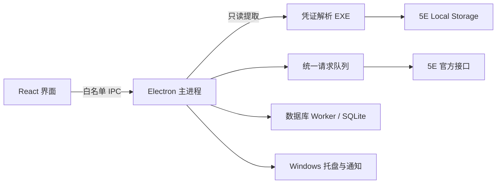

# 技术选型与工程规范

> v1.0 · 2026-11-07 · 第一期开发表达均为确定规则

## 1. 技术栈

| 层 | 确定选型 | 基线版本 | 用途 |
|---|---|---|---|
| 桌面宿主 | Electron | 45.2.3 | 窗口、托盘、通知、单实例、主进程 |
| 界面 | React / React DOM | 19.3.1 | G、P1–P7 |
| 语言 | TypeScript | 7.0.2 | 严格类型、主进程与前端共享契约 |
| 组件库 | Ant Design | 6.7.0 | 表格、抽屉、表单、模态、状态反馈 |
| 前端状态 | Zustand | 5.1.0 | 导航、表单、视图及主进程状态的投影 |
| 运行时校验 | Zod | 4.6.7 | IPC 输入、平台关键字段、持久化格式 |
| 金额 | Decimal.js | 10.6.0 | 十进制计算与元/分转换 |
| 本地数据库 | Electron 所带 `node:sqlite` | Node 24.22.2 / SQLite 3.53.4 | SQLite 事务、迁移、收藏和任务恢复记录 |
| 前端与桌面构建 | Vite / electron-vite | 8.3.6 / 6.0.0 | 前端、preload、主进程构建 |
| Windows 安装包 | electron-builder / NSIS | 26.18.0 | x64、当前用户安装、开始菜单、协议注册 |
| 业务测试 | Vitest | 5.1.0 | 领域规则、状态机、契约样例、调度器 |
| 格式化与静态规则 | Biome | 2.6.6 | TypeScript/JavaScript/JSON 格式与代码检查；不再叠加 ESLint/Prettier |
| 登录态辅助程序 | CPython + PyInstaller | 3.11.9 / 6.18.0 | 构建独立 EXE；使用端无需 Python |
| Chromium 存储解析 | ccl_chromium_reader | 0.3.19，提交 `ad37443541dd91dac3ac1fb2eecaeb8693f36815` | LevelDB、Local Storage 编码、Snappy |
| Snappy 解析 | ccl_simplesnappy | 0.4，提交 `3d085230baa8c46cf2090ebba29bf6e8eab31087` | 固定解析依赖 |
| 解析库附带依赖 | Brotli / zstd | 1.2.1 / 1.5.7.2 | 冻结构建依赖 |

构建环境使用 Node 24.14.0、npm 11.9.0。React 类型声明为 `@types/react` 和 `@types/react-dom` 19.3.0。直接依赖使用精确版本，不写 `^` 或 `~`；锁文件纳入 Git，CI 使用 `npm ci`。Python 的 Git 依赖固定提交。

选择 Electron 的依据是本轮已跑通的 Windows 安装、托盘、通知提交与协议激活，以及可直接集成的前端工程。Tauri、WPF、WinUI 不进入第一期。接受 Electron 的包体积，使用已经验证的单一实现路线控制维护成本。

`node:sqlite` 按固定 Electron 运行时使用，只采用 `DatabaseSync`、预编译语句和事务，并封装在数据库适配器中。官方接口处于 Release candidate 稳定性级别；项目通过固定版本和数据库回归管理升级，不将这一事实写成“稳定 API”承诺。[Node 文档](https://nodejs.org/api/sqlite.html)

## 2. 平台与分发

- 目标平台：Windows x64；最低 Windows 10 22H2，发布验收覆盖 Windows 10 22H2 与 Windows 11。第一期不构建 ia32、ARM64、macOS 或 Linux 包。
- 安装：NSIS 当前用户安装，不要求管理员权限；安装路径和快捷方式支持中文及空格。
- 产品名：饰品驿站助手。应用 ID：`io.github.camarillog.jewelryhelper`。URI scheme：`jewelry-helper`。Toast Activator CLSID 固定为 `{3D5F7673-DF85-49BB-BDE9-563EA5F5BEBD}`。
- 第一版安装包不购买签名证书；`win.signExecutable=false` 保留应用名称和图标资源编辑。发布安装程序、SHA-256 清单、版本说明和第三方许可；状态明确标注为未签名。
- 开发仓库保持私有；公开发布时依既定产品决定转为公开，项目代码采用 MIT 许可，保留第三方许可。
- 在线更新（2026-11-08 用户决定，取代原「不自动更新」）：使用 `electron-updater` 和公开的 GitHub Releases，每次启动延迟约 10 秒自动检查一次，用户也可手动检查；下载和安装都由用户点击触发，不后台自动下载，不在退出时静默安装，不降级，不接收预发布版本。更新请求不带平台凭证，不占平台请求额度，不遥测；出码或待处理订单未结束时禁止安装。安装包未签名，完整性依赖 `latest.yml` 的 `sha512` 与 HTTPS；关闭差分下载。检查或下载失败时提供打开发布页手动下载。
- 升级保留用户业务数据；卸载默认保留业务数据，卸载器另提供明确的清除选项。缓存可随卸载删除。
- NSIS 自定义卸载钩子在真正卸载时清除本应用的 URI scheme、Toast Activator CLSID、开始菜单快捷方式及 AUMID 注册。删除前校验注册项的目标可执行文件属于本次安装目录；被其他程序接管的关联不删除。覆盖升级不执行这段清理，安装完成后重新确保注册正确。

## 3. 进程与职责



| 边界 | 规范 |
|---|---|
| Renderer | 只加载随包的前端；无文件访问、无平台鉴权、无任意 HTTP 请求；只持有显示所需 DTO |
| Preload | `contextBridge` 暴露具名方法；不暴露 `ipcRenderer`、任意频道、文件路径读写或 shell |
| Main | 登录身份、API、调度、扫描、监测和订单状态的唯一管理者 |
| 数据库 Worker | 串行执行 SQLite 操作，避免同步数据库调用阻塞窗口线程 |
| 解析辅助程序 | 仅读取指定客户端数据目录；只通过父进程继承的匿名管道返回凭证，不写凭证文件、不打开网络端口 |

`nodeIntegration=false`、`contextIsolation=true`、`sandbox=true`。校验 IPC 来源窗口和每个参数；使用本地 `app://` 资源协议，生产 CSP 禁止远程脚本、内联脚本和 `eval`。外部文字按文本显示，图片仅允许受控 HTTP(S) 图像来源，图片请求不附带鉴权。[Electron 安全规范](https://www.electronjs.org/docs/latest/tutorial/security)

## 4. 登录态读取

1. 自动入口为 `%APPDATA%\5E对战平台\Local Storage\leveldb`；设置中允许用户指定另一个客户端数据目录。不枚举无关浏览器配置。
2. 只读取生产来源 `https://view-arena.5eplay.com` 的 `authorization` 键。
3. 读取 `CURRENT` 指向的 Manifest，按版本编辑重建有效 SST 集合及当前/前一日志编号；不扫描已淘汰文件寻找旧凭证。
4. 解码 `.log` 与 `.ldb/.sst`，处理 Snappy、Latin-1/UTF-16 值；按记录序列号选最新值。最新记录是删除或空值时认定未登录，不恢复历史值。
5. 解析前后比较文件集合、大小和修改时间；变化时最多重读 3 次，仍不一致则显示读取失败。只读打开源文件，不复制整个用户配置目录。
6. JWT 到期时间只作本地预判；身份和可用性由官方 `user/info/get` 确认。HTTP 200 内的业务 401 同样使登录态失效。
7. 凭证只驻辅助程序和主进程内存；不进入 Renderer、数据库、日志、崩溃附件、命令行参数或环境变量。
8. 读取失败时提示重试、重新登录或手动指定目录；不自动重启客户端、启用调试端口或通过 CDP 兜底。
9. 同一平台用户重新读取成功后恢复任务；用户身份变化时停止旧身份任务，切换独立数据库作用域，并保留旧身份的订单记录供切回处理。

解析库是取证工具，默认会枚举历史记录；项目适配层必须执行上述有效文件及最新记录规则，不能直接把其枚举结果当成当前登录态。[解析库资料](https://github.com/cclgroupltd/ccl_chromium_reader)

## 5. 本地持久化

业务数据放在 `%LOCALAPPDATA%\JewelryHelper\data\app.db`；图片和库存缓存使用独立子目录。数据库启用外键、WAL、`busy_timeout=5000`，写入采用事务。

| 表 | 主键与主要字段 |
|---|---|
| `profiles` | `profile_id`（官方用户 ID）、创建/最后使用时间；不保存 JWT |
| `favorites` | `(profile_id, account_no)`；本地是否收藏、监测开关、来源、最后可信状态、变化时间、通知周期 |
| `favorite_tombstones` | `(profile_id, account_no)`；移除时间、移除原因 |
| `favorite_sync_ops` | `(profile_id, account_no)`；最新目标状态、递增 revision、失败次数、下次尝试时间 |
| `order_presets` | `(profile_id, account_no)`；租期、数量、支付偏好、自动用券 |
| `filter_presets` | `id`；所属用户、唯一名称、版本化 JSON 条件、上次使用时间 |
| `account_snapshots` | `account_no`；归一化信息、来源、抓取时间、结构版本 |
| `inventory_cache` | `account_no`；库存 JSON、获取时间、到期时间、结构版本 |
| `order_attempts` | `attempt_id`；所属用户、账号、参数摘要、状态、支付订单 ID、平台截止时间、释放状态 |
| `notification_intents` | 随机 nonce；用户、账号、动作、预设摘要、创建/到期/消费时间 |
| `settings` | `(profile_id, key)`；版本化 JSON 值；目录等设备设置使用设备作用域 |
| `schema_migrations` | 迁移版本、应用时间 |

所有平台大整数标识保存为 TEXT，金额保存十进制字符串，时间保存 UTC Unix 毫秒。凭证、付款码内容和付款码 URL 不持久化；出码期间只驻内存。

迁移使用递增 SQL 文件，事务执行；迁移前用 SQLite 备份 API 备份数据库。迁移失败恢复备份并阻止写入，不静默新建空库。只保留最近 3 个迁移备份。

库存缓存默认 1 小时，支持本次运行/1 小时/6 小时/1 天；“本次运行”缓存不落盘。库存缓存磁盘上限 100 MiB，图片缓存 256 MiB、最长 7 天，按最近使用时间清理。收藏、预设和订单恢复记录不作为缓存删除。

## 6. Windows 集成

- 原生通知使用 Electron `Notification` 与 `toastXml`，包含文字、缩略图及“查看”“一键出码”两种动作；XML 必须转义。
- 通知主体和按钮采用 Windows `protocol` 激活，安装器注册 `jewelry-helper://notification`。使用固定 AUMID、开始菜单快捷方式及固定 Toast Activator CLSID；不得每次启动生成不同身份。
- 首次进程从 `process.argv` 读取激活参数，运行中的进程经 `second-instance` 接收；主进程单实例锁保证一份任务调度器。
- 激活参数只带版本、动作及随机 128 位 nonce；数据库保存 nonce 与账号、用户、预设的绑定，10 分钟有效且只能消费一次。无效、过期、跨用户或重放参数只能打开收藏页，不得创建订单。
- 出码动作消费 nonce 后仍走同一个手动出码入口和订单互斥，不直接调用创建接口。
- 托盘常驻；关闭主窗口隐藏，显式退出才停止进程。系统阻止通知时保留应用内可租标记和托盘提示，不修改 Windows 通知设置。
- 单账号通知和同轮合并通知规则见状态机文档；合并通知只有“查看”。

该方案的安装后冷启动和运行中唤起已经通过系统 URI 激活验证；原生通知提交、双动作 XML 和 COM 动作回调亦有验证记录。[Electron 通知](https://www.electronjs.org/docs/latest/api/notification)、[NSIS](https://www.electron.build/nsis.html)

## 7. 工程约定

```text
src/main/             生命周期、服务编排、平台适配、调度器
src/main/storage/     数据库 Worker、仓储、迁移
src/preload/          白名单 IPC 桥
src/renderer/         页面、组件、主题、界面状态
src/shared/           IPC DTO、Zod schema、领域枚举
native/auth-reader/   Python 解析适配与冻结依赖
tests/                单元、契约、集成及端到端用例
tools/validation/     本轮验证程序与锁文件
docs/                 产品与工程基线
```

开启 TypeScript `strict`、`noUncheckedIndexedAccess`，使用具名错误类型。主进程独占业务规则；界面不能另写一份计费或订单状态判断。格式化和静态检查在 CI 执行，测试不得读取开发者真实登录态。

日志仅记录操作类型、耗时、状态码和本地追踪 ID；不记录请求头、原始响应、支付 URL、身份标识和饰品持有者身份。保留 7 天，每文件 5 MiB，总量 20 MiB。诊断导出二次脱敏。
