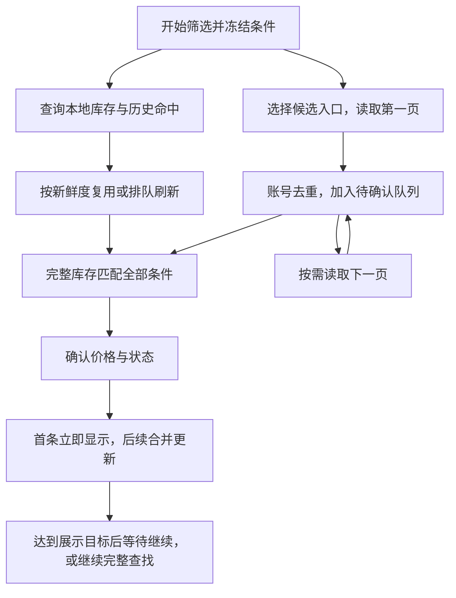

# 搜索筛选专项优化方案

> 2026-11-08 · 分析提案，尚未修改生产代码或替代现行规范。
> 依据：当前工作区源码、仓库已有接口验证记录、3 项新增临时离线诊断。本文没有重新调用真实平台，也没有验证已安装客户端与工作区的版本一致性。

核心建议：把“先收齐候选，再确认库存”改为“历史命中先返回，分页发现与库存确认交替进行，首个确认结果立即展示”。对整套饰品这种条件高度重叠的查询，减少无收益的关键词求交；对重复查询，先使用本地库存与历史结果，再刷新动态状态。目标分别衡量**首个可用结果时间**和**完整扫描时间**，不能把两者混为一谈。

复核时工作区另有新增的 [1.0.2 迭代草案](迭代-1.0.2.md)。本报告保留其内容，并在 §4.6、§7 补充与“搜索结果直接判定”和五分钟搜索缓存的衔接条件。涉及收藏卡片的改版不在此次搜索专项分析范围内。

## 1. 目标场景与匹配语义

本文按当前内置方案的实际语义分析：

```text
(蝴蝶刀 OR 爪子刀 OR 锯齿爪刀 OR M9 刺刀)
AND 任意手套
AND AK-47
AND M4A1 消音版
AND USP 消音版
AND 格洛克 18 型
AND 支持小时租
```

这代表“四种刀任选其一 + 手套 + 四把枪”，不是同时拥有四种刀。若要四种刀同时存在，应拆成四个 AND 条件行。建议预设显示名改成“四刀任选一 + 手套 + 四把主力枪”，摘要保留具体枪名，减少理解歧义。

沿用同件条件、行间 AND、命中饰品去重。列表的五个展示位只可帮助安排检查顺序，不能证明完整组合存在，也不能因展示位缺少某件而排除账号。

用户提到的“lazy catch”，在本方案中落实为三个行为：**发现并确认一个就显示一个；结果尚未齐全时继续发现；已查过的内容能在下次查询中提前复用。**

## 2. 当前实现的瓶颈与正确性问题

### 2.1 候选阶段形成主要等待

当前执行顺序：


对应 [scan-service.ts](../src/main/services/scan-service.ts)：

| 位置 | 现有行为 | 用户影响 |
|---|---|---|
| 157–164 行 | `collectCandidates()` 整体结束后才调用 `verify()` | 有足够信息验证第一页，也必须等后续分页 |
| 254–298 行 | 先探测所有关键词第一页，再按候选规模排序 | 此预设通常先查 8 个词；任意手套不提供关键词 |
| 300 行 | 只在剩余页数不小于当前候选数时跳过该行 | 没有判断这一行能否实际排除账号 |
| 332–345 行 | 本地已知账号在远程候选之后加入 | 之前已经确认过的整套账号无法优先显示 |
| 357–449 行 | 顺序确认库存，匹配后补充缺失的账号状态 | 未命中一般需要 1 次库存请求；命中且状态缺失时还需 1 次详情请求 |

`plan.pages >= intersection.size` 比较的是“继续翻页”与“检查全部候选”的粗略成本。假设已有 400 个候选，AK 还有 3 页，而这 400 个账号几乎都有 AK，程序依然会把 3 页全部读完，候选数却不变。整套账号的各项条件通常相关，不能把每个条件都当成独立、高效的过滤器。

### 2.2 增量展示已经存在，但启动过晚

`verify()` 每处理一个账号会更新结果，并经 `emitThrottled()` 推送，合并间隔约 300 ms。主进程控制器立即发出 `scan` 事件，前端订阅事件更新状态；[FilterPage.tsx](../src/renderer/src/pages/FilterPage.tsx) 在结果非空时就渲染，不要求 `phase === COMPLETE`。

因此，当前源码没有“必须全部完成才显示”的渲染门槛。等待主要发生在第一个账号尚未开始确认时。另有两个体验因素：

- 默认“仅可租”会隐藏已匹配但处于租赁中的账号；后台已有命中，结果区仍可能只有骨架屏。
- 缓存全部命中时，整个确认阶段可能少于 300 ms，首次非空事件会与完成事件合并。这本身不是长时间等待的来源；首条结果单独立即发送，可以统一行为。

若发布包在确认阶段持续几十秒、有可租命中却仍不显示，需要进一步核对发布包版本和事件链；此次代码分析不能替代对那个运行实例的验证。

### 2.3 缓存存在，但不能用于搜索启动

[account-service.ts](../src/main/services/account-service.ts) 已有库存缓存：默认 1 小时，支持本次运行、6 小时、1 天；详情状态有独立的 30 秒内存缓存。库存还持久化在 SQLite 中。

缺少的是：

1. 搜索启动前查询本地完整库存的入口；目前是先拿到远程候选，才逐个按账号读取缓存。
2. 条件到历史命中账号的索引、库存分类索引、候选页缓存及关键词规模统计。
3. 账号库存/详情的在途请求合并：扫描、打开详情等调用可能在第一次请求完成前分别排队。
4. `knownAccounts()` 返回账号记录时没有保留快照时间，难以直接支持“多久前验证”的展示。

本地来源账号当前还会先强制刷新详情，再检查库存。在缓存能明确排除该账号时，这次详情请求没有帮助筛选。

### 2.4 请求预算决定了全量扫描的下限

[queue.ts](../src/main/platform/queue.ts) 规定全局同时最多一个业务请求，默认 30 次/分钟，相邻请求起点至少间隔 2 秒。监测、详情、订单也共享这份预算。

在无其他请求、无退避且响应足够快时，发送 R 个请求，最后一次请求最早约在 `2 × (R − 1)` 秒发出，之后还要等响应。不是所有候选都只花一次请求：完整库存匹配后，列表状态未知还需要详情。

因此应优先减少请求数量、改变请求顺序。仅提高前端刷新频率或堆叠 Promise，并不能消除这个下限。

### 2.5 已有实测记录揭示关键词会漏召回

[验证记录.md 的搜索语义补充](验证记录.md#补充搜索关键词语义实测2026-11-08只读)记录了同日既有实测：

| 搜索词 | 记录中的 total |
|---|---:|
| 格洛克 | 0 |
| 格洛克18型 | 135 |
| M4A1 | 210 |
| USP | 188 |
| AK / AK-47 | 1,827 / 1,847 |

这些是仓库记录中的历史观察，不是本次重新测得的实时数量。它们说明平台匹配规则不是简单名称子串；不同写法的召回也可能不等价。

当前 [catalog.ts](../src/shared/catalog.ts) 的格洛克关键词仍是“格洛克”。`collectCandidates()` 会把该行 total=0 视为整个交集为空，只剩本地已知账号有机会继续检查。这会产生“其实有整套账号，却返回零结果”的问题，必须与性能优化一起处理。

离线虚拟平台使用 `marketName.includes(keyword)`，不能发现这一契约差异；不能把现有离线测试通过视为关键词召回正确的证据。

### 2.6 中断和完整性反馈存在缺口

- 候选阶段的关键词、分页和集合保存在函数局部变量；停止后继续，会重新取第一页。现有恢复游标主要覆盖库存确认阶段。
- 界面的停止按钮只在 `VERIFYING` 分支显示，最漫长的 `CANDIDATES` 阶段没有对应入口。
- 达到每关键词 200 页上限时，若仍未达到 total，当前代码没有明确置为不完整。提前出现空页且条数未齐，也存在同样问题。
- 分页失败得到的局部集合仍可能参与硬交集，虽然标注了“不完整”，也会丢掉原本可由其他候选来源继续确认的账号。

## 3. 离线验证结果

使用现有真实业务服务、内存数据库和 `FakePlatform`，新增了 3 项临时诊断，全部通过。模拟测试把限速调高以便快速检查调用顺序，**运行耗时不能当作平台真实性能**。以下请求数和执行阶段来自实际诊断输出。

### 3.1 高度重叠的 400 账号场景

400 个模拟账号都符合整套条件；四种刀各出现于 100 个账号，手套和四把枪出现在所有账号；搜索列表不带可用状态。

| 指标 | 第一次筛选 | 立即重复筛选，库存和详情缓存仍有效 |
|---|---:|---:|
| 搜索请求 | 20 | 20 |
| 完整库存请求 | 400 | 0 |
| 账号详情请求 | 400 | 0 |
| 第一次库存读取前的搜索请求 | 20 | 无库存网络请求 |
| 候选阶段出现结果 | 否 | 否 |
| 首次非空事件 | VERIFYING，已确认 11 个 | COMPLETE，400 个 |

关键结论：现有增量推送有效；缓存也有效，但两者都被完整候选收集挡在后面。上述“11 个”只是本次合并计时的观察值，不是固定批量大小。

按默认 30 次/分钟推算，20 次搜索后再读取第一个命中账号的库存和详情，首个结果理想情况下也约需 **42 秒加最后响应时间**。全量 820 次请求，最后一次最早约在 **27 分 18 秒**发出；实际还受其他请求、响应时间和重试影响。

如果使用一个足以覆盖目标的必要条件作为候选入口，第一页就开始确认，而且第一个候选刚好匹配：首条仅需“搜索 + 库存 + 详情”3 次请求，理想情况下约 **4 秒加最后响应时间**。这是请求预算推算，不是已实现的提速测试，也不保证任意查询都能这么快命中。

即使把 20 次搜索压到 4 次，该模拟场景仍需 800 次库存/详情请求，全量仅减少 16 次请求、约 32 秒。**流式化显著改善首条等待；要显著缩短全量耗时，还需要有效收窄候选和缓存复用。**

### 3.2 其他两项诊断

| 诊断 | 观察结果 |
|---|---|
| 对确实有整套饰品的 1 个模拟账号，把“格洛克”搜索响应重放为零 | 8 次搜索、0 次库存请求、0 个结果，且 `incomplete=false` |
| 候选阶段已发出 3 次搜索后停止再继续 | 重新从“蝴蝶刀，第 1 页”开始 |

本机诊断文件位于 Git 忽略目录 `.validation/search-analysis/`，包含测试、配置和 `results.json`。复现命令：

```powershell
node node_modules/vitest/vitest.mjs run --config .validation/search-analysis/vitest.config.mts
```

这三项诊断用于证明现状，没有改动生产业务实现。

## 4. 推荐方案：流式发现、精确确认、本地优先



图中的两条入口可以同时准备工作，但远程请求仍由现有单队列串行执行。无需增加平台并发。

### 4.1 选择候选入口，不必每次先查全部条件

一个账号要符合整套条件，必然满足每个必选条件。因此可以选择**覆盖目标账号的一个必要条件**作为入口，获取其候选后，用一次完整库存检查所有条件。

建议策略：

1. 先尝试从历史查询统计选择召回可靠、候选较少的条件。没有历史时，这类整套预设可以优先尝试已验证写法的格洛克或 M4A1；具体顺序应由请求成本和实际命中率修正。
2. 读到第一页就安排确认，不等待其他七个关键词的统计返回。
3. “任意手套”和其他主力枪在完整库存中检查；只有预计能省下更多确认请求时，才额外取某条件的分页用于收窄。
4. 对 OR 条件作为入口的情况，完整扫描必须覆盖该行的所有有效分支。不能只查最少的某一种刀，就宣称“四刀任选一”已经全量完成。
5. 若关键词召回范围不可靠，使用已验证的别名集合或更宽的入口；仍无法保证覆盖时，可回退为空关键词浏览，并明确本次覆盖范围。不能把未知关键词的零结果当作“全平台无匹配”。

第 1 点不是把“格洛克18型”永久写死为唯一入口。既有记录中的 135 个账号只提供规划线索；有结果不等于已证明无遗漏。候选入口的覆盖能力、分页完整性、源数据变化都需要独立记录。

**正确性前提**：只有候选入口确实覆盖目标账号时，跳过其他关键词分页再做完整库存确认才与完整 AND 查询等价。平台不提供快照一致性，最终文案仍应是“本次搜索范围内完成”，不承诺某一时刻的全平台穷尽结果。

### 4.2 分页与确认交替调度

把一次扫描改为可保存的任务上下文：

```text
scanId、条件快照
候选来源及各关键词下一页、已读页、是否耗尽、失败页
seenAccountNos、待确认账号队列、已确认账号集合
结果映射、失败账号集合、覆盖不完整的具体原因
```

默认先处理已有候选。待确认队列低于阈值时再读一页，避免一次把所有搜索分页排到队列前面。初始可设低水位 20、高水位 200；按每页 100 个账号估算候选缓存大小，后续用测量结果调整。需要切换候选来源时，也应在请求之间决策。

确认顺序可以优先：有效缓存中的历史命中、近期确认可租的账号、价格符合当前偏好的账号、其他未验证候选。启发式只影响顺序，不能替代库存判定或把未检查的账号视为不匹配。

在“仅可租”的目标下，可利用**足够新且来源可信**的状态调整顺序。已知租赁中的账号保留在其他状态队列；切换“全部”后继续处理。不要用陈旧状态永久排除候选。

### 4.3 首条命中立即推送，后续小批量更新

- 第一个满足当前展示条件的确认结果立即 `flush()`；后续按 100–300 ms 或小批量合并。
- 以 `accountNo` 做 upsert，避免多来源、多个刀分支、缓存与刷新重复显示。
- 已有结果保持可见；后续候选、局部失败和限速等待不把列表重新清空成骨架屏。
- 主进程和渲染层都校验 `scanId`；需要增量事件时再加入单调事件序号，支持丢事件后通过完整快照恢复。
- 卡片显示每项要求的命中摘要，例如“刀 ✓ 手套 ✓ AK ✓ M4A1 ✓ USP ✓ 格洛克 ✓”；现有按估值截前四张图的方式不能直观看出整套齐全。

首版可继续发送现有完整 `ScanView` 快照，先消除前置等待。结果量和事件频率确实变大后，再增加 `scan.delta`，无需在首次改造时同时重写全部 IPC。

### 4.4 本地缓存提前查询，区分库存与可租状态

建议按以下层次实现：

| 数据 | 用途 | 有效性要求 |
|---|---|---|
| 完整库存缓存 | 精确检查所有饰品条件 | 沿用用户设置的 TTL 和 schema 版本 |
| 库存摘要/分类索引 | 快速找到可能具备整套的本地账号 | 绑定库存版本；清理或过期时同步失效 |
| 条件对应的历史命中 | 重复查询先显示候选 | 保存条件指纹、账号、库存验证时间、状态验证时间、来源 |
| 搜索分页缓存与规模统计 | 减少规划请求、给下次查询提供候选 | 对接 1.0.2 草案的 5 分钟缓存窗口；标明快照时间，统计只用于排序，不用于判空 |
| 在途请求映射 | 合并同账号、同类读取 | 区分普通读取与强制刷新；取消一个消费者不应影响其他消费者 |

关键规则：

1. 本地“库存确认符合”与“当前可租”分别表示。库存可复用，不代表小时价格、租期支持和租赁状态依然有效。
2. 库存有效、状态过期：先显示在“历史命中，状态待刷新”区域，或提供明确待确认标记；不能直接计入“当前可租”。刷新状态后移入正式结果。
3. 库存过期：历史记录只能帮助安排刷新顺序，不作为当前条件已满足的正式证据。当前缓存 TTL 内的结论也要展示验证时间。
4. 本地账号先检查可用库存证据，再为命中账号刷新动态状态；不必为每个必然不匹配的缓存账号先取详情。
5. 查询缓存只负责给出已知候选，不能因历史缓存为空便宣称无结果；缓存中没有出现的账号不能作为“不匹配”证据。
6. 条件指纹包含规范化条件、租期、价格范围、用券条件和匹配规则版本。涉及用户范围和收藏的数据按用户隔离；排序不改变匹配集合，可复用同一份结果。
7. 合并请求时保留独立消费者；用户手动刷新不能被普通陈旧缓存短路，也不能被扫描取消误伤。退出、切换用户时清理对应任务上下文。
8. 五分钟内复用搜索页可以省请求，但会错过期间新增或重新上架的账号。默认显示“基于 N 分钟前的候选”，提供强制刷新；涉及历史价格、用券条件的过滤同样需检查动态数据。若要后台刷新，不能同时承诺“五分钟内绝不发送搜索请求”。

首版只需增加批量读取有效库存和账号快照时间的接口，优先处理历史命中。后续再引入结构化索引；不需要外部搜索服务或向量数据库。

### 4.5 给“先找几个”和“完整查找”不同的停止条件

整套租号的常见目标是尽快找到可用选择，建议提供两种模式：

| 模式 | 行为 | 结果说明 |
|---|---|---|
| 快速查找，建议作为此预设的默认模式 | 先找 20 个符合当前展示条件的账号，达到目标后保存任务，用户可继续找更多 | “已找到 20 个，仍有候选未检查”；数量是建议初始值 |
| 完整查找 | 持续发现并确认，直到所选候选范围耗尽或发生不可恢复中断 | 持续显示结果，最终说明覆盖范围及缺页/失败 |

达到展示目标应使用独立的暂停原因，不能标成 COMPLETE。切换“全部/可租”等展示条件时，更新目标计数并根据保留队列继续处理，不重复从头搜索。

“快速查找”改变了完整收集的停止条件，实施时需同步更新产品文档和状态机。默认只按**当前已确认结果**排序，不宣称是全平台最低价前 20 个。若平台排序字段未经验证，不能通过提前截断实现全局 Top-K。

### 4.6 进阶路径：类别搜索证明匹配，完整库存按需加载

1.0.2 草案 A3 提出了另一条能减少全量请求的路径：对只有类别条件、且搜索词经过精确性验证的行，使用平台搜索的账号集合证明条件成立。所有行的集合相交后，只补动态状态，库存留到打开详情或需要精确件数时读取。

该路径值得作为专项加速器，但需要区分“完整库存已核验”与“平台搜索证据匹配”：

| 条件/数据 | 可以使用搜索证据的前提 | 不能由它代替的内容 |
|---|---|---|
| 只有具体武器类别 | 对该关键词已验证返回结果的精确性，且已验证可接受的覆盖范围 | 不能仅凭 total 大于零就认证精确 |
| 同行多个类别 OR | 该行所有分支都有有效搜索映射，账号命中任一分支 | 不能少查一个分支后宣称完整覆盖 |
| 任意手套等大类 | 词典展开覆盖整个大类，包括裹手，且映射版本化 | 不能用“手套”一个词代表所有手套 |
| 类别加皮肤、复杂名称 | 继续用完整库存确认同件语义 | 账号同时命中两个词，不代表同一件饰品满足两项 |
| 命中件数、具体命中图片、按匹配度排序 | 已有有效完整库存时才计算 | 搜索返回的是账号集合，不能推导准确的去重件数 |

这里要分别验证精确率和覆盖率：抽查命中库存能发现误匹配，但不能独立证明没有漏召回；应结合已知库存样本、多种别名和较宽来源交叉核对，并保留验证版本、范围与回退机制。三个正例也不足以把所有类别标为精确。

这条路径同样可以流式执行：每收到一页，更新账号已满足的条件行；当某账号所有行均有可信搜索证据时，就输出“组合已由平台搜索匹配，状态待确认”，不等所有页结束。某页暂时没出现一个账号，不能当作该账号不满足条件；只有来源完整性得到确认后，才能作相应排除。

预期网络成本可从“搜索页数 + 待检查候选数的库存请求 + 命中账号状态请求”，降为“搜索页数 + 命中账号状态请求 + 用户按需读取的库存请求”。这是明显减少完整扫描成本的机会，代价是需要建立更强的搜索契约，并为未加载库存的卡片取消精确匹配件数和对应排序。后续加载库存若发现不符，应撤销结果、记录契约偏差并禁用该关键词快速路径。

它改变了现行规范“含饰品条件都读取完整库存”的要求。建议作为单独的优化开关或小范围试运行项验收；未通过关键词契约验证的条件继续走 §4.1–4.4。两条路径共享流式输出、缓存、状态刷新和中断恢复能力。

## 5. 查询规划的进一步优化

第一版不必建立复杂优化器，先使用“一个可靠入口 + 流式验证”。积累统计后再决定是否值得补查其他关键词。

可使用如下成本判断：

```text
额外分页成本 = 该条件尚需读取的页数
预计收益 = 可排除候选数 × 每个候选的预计剩余网络请求数

只有预计收益明显大于额外分页成本时，才执行额外收窄。
```

“可排除候选数”应来自完整库存的抽样、历史重叠率或可靠的候选统计；不能根据排序列表第一页没有出现某账号，就判断该账号不满足这个条件。整套预设的刀、手套和枪之间相关性强，也不能直接相乘各行独立概率。

有有效库存缓存的候选，剩余网络成本可能为零或仅一次状态刷新，应降低为它们追加关键词分页的优先级。对于“指定稀有皮肤 + 其他条件”的查询，保留稀有条件驱动的收窄路径。

可将原来经完整验证、仍有价值的求交策略保留为窄查询路径；不完整分页只能补充或排序候选，不能用于硬性排除可靠入口中的账号。

其他后续改进：

- 当前 `api.search()` 固定发送 `price: []`，价格在本地过滤。若后续确认平台价格参数的格式、边界和租期含义，可把价格范围下推；现有字段存在不足以证明具体语义，第一版不依赖它。
- 本地匹配先为每件库存归一化名称、武器前缀和大类，避免每个条件反复计算。分类位图或索引只做粗筛，最终仍用同件规则确认，并保留完整命中计数。
- 大量缓存读取时按批次处理，避免在主进程一次解析数十万条饰品阻塞交互；优先利用现有 SQLite worker。
- 前端已有虚拟网格，现阶段不是主要瓶颈。若缓存瞬间返回大量结果，再测量全量排序、IPC 序列化和滚动稳定性；用户滚动时可提示“新增 N 个结果”，避免不断重排造成位置跳动。

## 6. 完整性与中断恢复

流式化后，不能继续用“候选收集完 → 库存确认完”的互斥阶段表达全部状态。建议采用“准备 → 搜索中 → 完成”，并增加独立字段：

```text
discoveryDone、discovered、verified、pending
matches、visibleMatches、cacheHits
currentSource/currentPage
coverage: pending | complete | partial
incompleteReasons、pauseReason
```

“搜索中”同时允许发现和确认；发现未结束时不显示虚假的固定百分比。推荐文案：

> 已找到 6 个可租账号 · 已检查 38 个 · 还有 62 个待检查 · 正在继续发现

需要同时满足以下条件，才可结束为本次范围完成：所有选定来源已耗尽、无待确认账号、无未处理的失败页或账号。若存在失败、截断或无法确认覆盖，保留结果并明确 partial，不应笼统显示“全部找到”。

停止时保存来源游标、去重集合、待确认队列和结果；继续时复用已成功读取的页。已发送请求可能返回，须经过 scanId/任务代际检查才能更新当前任务。自动退避中的旧请求也必须在再次入队前检查取消状态。

长时间暂停后，平台采用页码分页可能因为上下架导致位置变化；可以按新一轮发现重新核对并利用去重和缓存减少成本，但必须标注数据重新校验。不能把跨时刻拼接的页声称为一致快照。

## 7. 实施顺序与涉及文件

| 阶段 | 交付内容 | 主要位置 | 预期改善 |
|---|---|---|---|
| P0：正确性和测量 | 修正已知失效关键词；加入真实搜索语义回放；零结果回退；补齐分页截断标记；记录首次命中及各类请求数 | `catalog.ts`、`matching.ts`、`scan-service.ts`、测试夹具 | 避免假空结果，为性能比较建立基线 |
| P1：消除前置等待 | 单入口分页发现与库存确认交替；首条立即推送；所有活动阶段可停止；保存分页游标；动态计数 | `scan-service.ts`、`dto.ts`、`FilterPage.tsx`、相关 IPC | 不必等候选全部收齐才出现可用结果 |
| P1 配套：本地先返回 | 批量读取有效库存及时间；历史命中优先；库存证据与状态新鲜度分开显示 | `account-service.ts`、`storage/ops.ts`、`dto.ts`、结果卡片 | 重复查询快速获得已有匹配 |
| 条件满足后专项加速 | 精确类别搜索的逐页条件交集；库存按需读取；明确证据来源、禁用未确认的匹配件数 | 关键词契约、扫描规划、`dto.ts`、结果卡片 | 减少大量冷启动库存请求，适用边界见 §4.6 |
| P2：减少重复请求 | 库存摘要索引、查询结果缓存、短期分页缓存、在途请求合并、基于收益的额外求交 | 存储迁移、账号服务、扫描规划 | 降低重复筛选及全量扫描成本 |
| P2：按需继续找 | 快速查找目标、找更多、完整查找、稳定排序与覆盖提示 | 产品文档、状态机、筛选页 | 搜索工作量更贴合实际找号需求 |

建议把 **P0 + P1 + 本地历史命中先返回** 作为第一批交付。首批先沿用现有完整扫描的结束规则，边搜边显示；“找到 20 个后暂停”作为后续明确的产品行为上线，避免把部分结果悄悄当作全量结果。

与 1.0.2 草案合并时，另需校正两个前提：当前库存缓存默认值实际是 **1 小时**，不是“本次运行”；“收紧价格后上次结果的子集即准确”只对同一完整快照成立，遇到旧结果本就不完整、价格变化或新增上架时仍需补充发现。不要把扩大 TTL 作为算法提速的主要手段。

受影响需求为 F1.3、F1.6、F1.7、N3。实施时同步修订产品文档 §3.3、Q19/Q28/Q35、业务流程 §3，以及数据和 IPC 规范；上述提案目前不改变既有规范。

## 8. 验收指标与回归范围

### 8.1 量化指标

| 指标 | 建议验收方式 |
|---|---|
| 首个确认结果时间 | 分别测冷启动、有效库存缓存、状态也有效三种情况；记录 p50/p95 |
| 首个可租结果时间 | 与“首个历史命中”分开统计，防止靠陈旧状态制造秒出效果 |
| 流式正确性 | 人为阻塞后续页，第一个账号验证完成后仍能收到非空事件，且扫描尚未 COMPLETE |
| 事件延迟 | 首次匹配提交后立即发事件；离线端到端展示目标 ≤300 ms，不含平台等待 |
| 本地先返回 | 有限规模测试中，有效历史命中目标 ≤1 秒；状态过期时显示待刷新，不承诺 1 秒内确认可租 |
| 请求节省 | 在 400 个高度重叠账号夹具中，不为无收窄收益的四把枪反复完整分页；单可靠入口理论只需 4 个搜索页 |
| 重复查询 | 先展示本地命中，再按缓存时效补请求；有效库存不重复读取 |
| 缓存与未知处理 | 同时记录缓存命中率、详情/库存请求数、失败数和 incomplete 原因，不能用漏查换速度 |
| 全量等价性 | 静态完整数据集中，完成后的结果集合与全库存穷举匹配一致；任意手套、OR 刀型均不得漏掉 |
| 中断恢复 | 候选阶段停止后立即保留结果；正常短暂停止/继续不重取已成功页；旧扫描结果不进入新扫描 |
| 请求约束 | 所有请求继续遵守全局速率、订单优先与平台退避 |

冷启动不能给所有查询统一承诺“3 秒出结果”：在默认预算下，3 个网络请求本身就至少跨 4 秒，且可能先检查多个不匹配账号。验收应约束“首条不再等待全部分页”，并报告实际命中分布，而不是承诺固定时长。

### 8.2 必须覆盖的案例

1. 单个稀有皮肤、只有大类、整套预设、无饰品条件的租期浏览。
2. 四刀任选一与四刀同时存在；同一行类型和皮肤必须来自同一件饰品。
3. 手套包含裹手；M4A1 消音版/消音型；格洛克带空格/不带空格；平台不按子串召回的重放。
4. 冷缓存、库存有效但状态过期、库存过期、缓存损坏、清除缓存、切换用户。
5. 当前显示“仅可租”，已发现的命中全部租赁中；应解释隐藏数量，不能只有无限骨架屏。
6. 后续页失败、早于 total 的空页、重复页、200 页截断、total 变化；保留已确认结果并准确标注覆盖。
7. 快速重新筛选、停止/继续、401、429、支付暂停、旧请求在重试退避后回来。
8. 扫描和详情同时读取一个账号：请求能合并，强制刷新和取消语义仍正确。
9. 搜索证据加速路径：宽关键词不能当精确词；未读库存时不虚构件数；后续完整库存发现不符能撤销结果并降级查询；多页尚未收齐时已满足全部条件的账号可以先显示。

此次完成的是分析与离线取证。真实环境中的首次命中耗时、关键词覆盖和价格参数语义，应在实施时按受控只读验证补充，不能由本报告的模拟数据代替。
